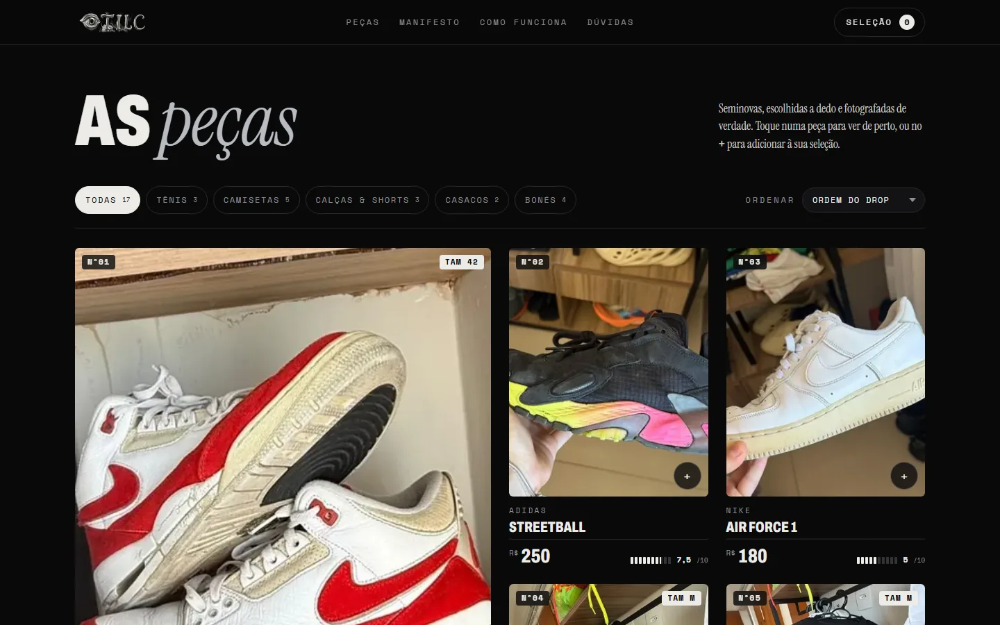
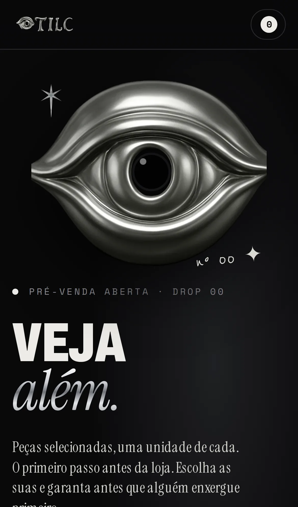
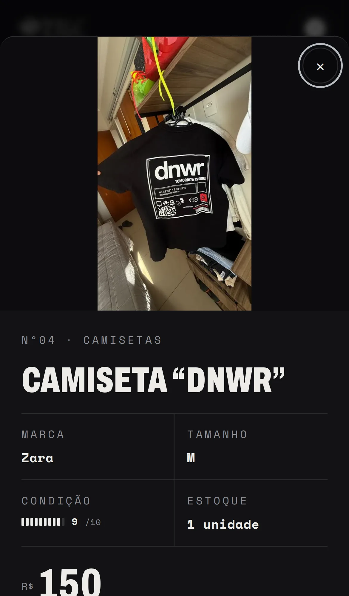
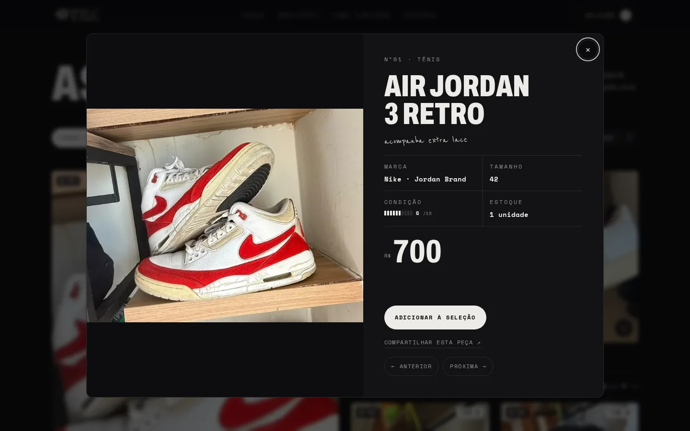
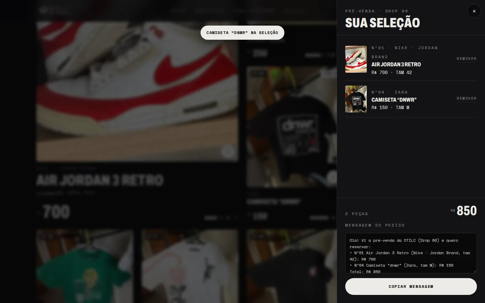

# OTILC: vitrine da pré-venda (Drop 00)

[](https://github.com/devpedroeduardo/otilc-landing/actions/workflows/ci.yml)


Vitrine de pré-venda da **OTILC**, marca de roupas que está nascendo. São peças seminovas, uma unidade de cada, e o pedido é fechado pelo WhatsApp.
Este é o primeiro passo antes da loja completa da marca, e a base visual dela.

**[Ver o site no ar →](https://devpedroeduardo.github.io/otilc-landing/)**



<p align="center">
  
  &nbsp;
  
</p>

---

## O problema

Antes de lançar a loja, a OTILC queria fazer o desapego de um lote de peças únicas. Isso trazia três desafios:

- **Cada peça tem uma unidade só.** Um checkout tradicional, com estoque e carrinho, seria pesado para isso. A venda é combinada no WhatsApp.
- **Cara de marca, não de brechó.** A pré-venda é o primeiro contato do público com a OTILC.
- **Fácil de atualizar** quando uma peça é reservada ou vendida.

## A solução

Um site estático, rápido e sem build, que funciona como uma vitrine.

| Recurso                       | Como funciona                                                                                          |
| ----------------------------- | ------------------------------------------------------------------------------------------------------ |
| **Seleção sem cadastro**      | O visitante monta a seleção, que fica salva no aparelho (localStorage).                                |
| **Pedido pronto no WhatsApp** | A seleção vira uma mensagem com nº, tamanho e total, e abre o WhatsApp da loja.                        |
| **Régua de condição 0–10**    | Deixa transparente o estado de cada peça seminova.                                                     |
| **Peça vendida/reservada**    | Fica em cinza no fim da grade, como prova de que as peças saem, e não pode ser adicionada.             |
| **Link por peça**             | `#peca-01` abre a peça direto, pronto para compartilhar no Instagram e no WhatsApp.                    |
| **Galeria e medidas**         | Fotos extras e medidas por peça, quando houver.                                                        |
| **O olho**                    | Elemento da marca que segue o cursor e pisca. Fica desligado com `prefers-reduced-motion`.             |
| **LGPD**                      | GA4 e Meta Pixel são configuráveis, mas só carregam depois do consentimento. Há página de privacidade. |

<p align="center">
  
  
</p>

## Decisões técnicas

- **HTML, CSS e JavaScript puros, com ES modules e sem build.** Para uma vitrine de 17 peças, um framework aumentaria o peso e a manutenção sem trazer ganho. O código é modular para migrar fácil depois (veja _Próximos passos_).
- **Dados separados do código.** As peças ficam em [`data/products.json`](data/products.json). Atualizar o drop não exige mexer em JavaScript, e o arquivo já tem o formato de uma futura API ou CMS.
- **Regras puras isoladas** em [`js/lib/`](js/lib), sem DOM: ordenação, mensagem do pedido, links e dados estruturados. Assim são testadas direto no Node.
- **Estado com publish/subscribe** em [`js/state.js`](js/state.js). As views não se chamam entre si. Elas reagem a `emit("selection")` e `emit("filter")`.
- **Pipeline de imagens.** [`scripts/optimize-images.js`](scripts/optimize-images.js) usa o sharp para gerar WebP em 400 e 800 px. O `srcset`/`sizes` segue a largura real do card em cada layout.
- **Acessibilidade de verdade**: painéis com `role="dialog"`, foco preso e devolvido ao fechar, navegação por teclado (Esc e setas), nomes acessíveis nos cards e animações respeitando `prefers-reduced-motion`.

## Qualidade

| Verificação       | Ferramenta                                   | Resultado                                                       |
| ----------------- | -------------------------------------------- | --------------------------------------------------------------- |
| Performance e SEO | Lighthouse (mobile e desktop)                | **98–100** em Performance, Acessibilidade, Boas práticas e SEO  |
| Acessibilidade    | axe-core (WCAG 2.1 AA) dentro dos testes E2E | 0 violações sérias ou críticas                                  |
| Fluxos do usuário | Playwright, 16 cenários × desktop e mobile   | 32 testes                                                       |
| Regras e dados    | `node:test`                                  | 18 testes, incluindo a validação do `products.json` e das fotos |
| Imagens           | sharp                                        | **−73%** no celular (1,28 MB em JPG → 342 KB em WebP 400 px)    |
| Estilo de código  | Prettier + ESLint                            | obrigatório no CI                                               |

O [GitHub Actions](.github/workflows/ci.yml) roda tudo a cada push e pull request. O deploy no GitHub Pages **só acontece se tudo passar**.

```
qualidade (format, lint, unitários) ──┬── E2E + acessibilidade ──┬── deploy (GitHub Pages)
                                      └── Lighthouse ────────────┘
```

## Rodar localmente

Requer Node 20 ou superior.

```bash
npm install
npm run dev            # http://localhost:8080
```

| Comando                     | O que faz                                                            |
| --------------------------- | -------------------------------------------------------------------- |
| `npm test`                  | testes unitários + E2E (`npx playwright install chromium` na 1ª vez) |
| `npm run check`             | formato + lint + testes, o mesmo que o CI                            |
| `npm run lint` / `format`   | ESLint / Prettier                                                    |
| `npm run images`            | gera as versões WebP de fotos novas em `assets/img/`                 |
| `npm run lighthouse:local`  | Lighthouse com o site rodando em `npm run dev`                       |
| `npm run screenshots`       | atualiza as imagens deste README                                     |
| `npm run site-url -- <url>` | troca o endereço público em canonical, Open Graph, sitemap etc.      |

## Estrutura

```
index.html, privacidade.html, 404.html
css/styles.css           visual completo (tokens de cor e tipografia no :root)
data/products.json       as peças do drop
js/
  main.js                inicialização e ligação estado → views
  config.js              contato (WhatsApp/Instagram) e métricas
  state.js · actions.js  estado da página e ações do usuário
  lib/                   regras puras e testáveis (catálogo, schema.org)
  views/                 catálogo, seleção, painel da peça, diálogos, contato
  consent.js · seo.js · effects.js
scripts/                 imagens, screenshots, Lighthouse local, URL do site
tests/unit · tests/e2e   node:test · Playwright + axe
```

## Atualizar o drop

As peças ficam em `data/products.json`:

| campo                    | o que é                                                        |
| ------------------------ | -------------------------------------------------------------- |
| `no`                     | número da peça (também vira o link `#peca-01`)                 |
| `cat`                    | categoria (`tenis`, `camisetas`, `calcas`, `casacos`, `bones`) |
| `name`, `brand`, `price` | nome, marca e preço                                            |
| `size`, `measures`       | tamanho e medidas (sem tamanho aparece "Consultar")            |
| `cond`                   | condição de 0 a 10, ou `null` para "sem nota"                  |
| `img`, `imgs`            | foto principal e extras (nomes em `assets/img`, sem `.jpg`)    |
| `note`                   | anotação à mão                                                 |
| `status`                 | `"reservado"` ou `"vendido"` (sem status = disponível)         |
| `feature`                | `true` para o card grande de destaque                          |

Fotos novas: coloque o `.jpg` em `assets/img/` e rode `npm run images`. Um teste falha se alguma foto citada estiver faltando.

**Antes de divulgar:** preencha o WhatsApp e o Instagram em [`js/config.js`](js/config.js) e confirme as respostas da seção "Dúvidas" com a loja.

## Próximos passos

- [ ] Fotos de detalhe (sola, etiqueta, defeitos) e medidas de todas as peças
- [ ] Lista de espera com cadastro próprio (hoje o cadastro é feito pelo WhatsApp)
- [ ] Site principal da marca em **Astro + TypeScript**, reaproveitando os tokens visuais, `js/lib` e os testes
- [ ] Peças vindo de um CMS headless, no lugar do JSON

## Licença

O código está sob [MIT](LICENSE). A marca OTILC, o logotipo, os textos e as fotos **não** estão incluídos na licença: pertencem à OTILC e são usados com autorização.
